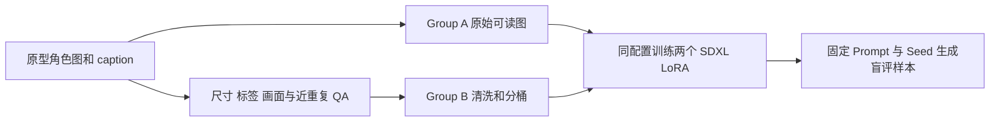

# LoRA 数据品控 A/B 实验




## 快速运行

Python 3.11 或以上。下列数据质检和绘图在 CPU 上运行。

```bash
python -m pip install -r requirements.txt
python curate_lora_dataset.py
```

在 CUDA 环境验证最小训练与评测闭环。

```bash
python -m pip install -r requirements-train.txt
python train_lora.py configs/smoke_a.toml configs/smoke_b.toml
python train_lora.py configs/smoke_a.toml configs/smoke_b.toml --evaluate
```

完整 SDXL 训练与盲评可以打开 [Colab 笔记本](https://colab.research.google.com/github/lubin010319/lora-data-curation-exp/blob/main/train_and_eval_colab.ipynb)，选择 GPU 后执行全部单元。AutoDL 用同样依赖和命令，把 `configs/smoke_a.toml`、`configs/smoke_b.toml` 换成 `configs/train_a.toml`、`configs/train_b.toml`。首次下载全尺寸 SDXL 权重需要数 GB 磁盘空间。

## Group A / Group B

- **A 有 14 张**，保留全部可解码图和原始 Caption。
- **B 有 8 张**，过滤 6 个可追溯样本，原因分别为水印、多角色、低清、冲突 Tag、近重复和极端比例。保留图的 Caption 去重复并按桶裁剪。水印与多角色使用 Caption 和审核字段，真实数据可接入人工或模型预审再进入此脚本。
- 分桶按相邻长宽比和 64 像素步长选择近似等面积桶。图表展示约 1024 像素目标面积下的分布。训练和裁剪配置为 512 目标值，小模型 smoke 为 128。
- 两组训练固定基座、rank、学习率、更新步数和 seed。使用 Diffusers + PEFT 给 SDXL UNet 的注意力模块加 LoRA。配置分别指定数据集路径和输出路径，训练只使用本次生成的 manifest。

自有材料可用 `python curate_lora_dataset.py --manifest path/to/manifest.jsonl`。每行有唯一 `id`、相对 `file`、逗号分隔 `caption`，可提供 `people`、`watermark`、`license` 字段。审核细目在 `work/curation_audit.json`。

## 实测边界

RTX 4070 Ti 上用 Hugging Face 的 **tiny SDXL 测试 checkpoint** 完成每组 2 步，保存并重新载入两个 LoRA，跑通 3 条 Prompt × 2 个 Seed × 2 组的 12 张评测图与盲评表。实验产物在忽略的 `work/` 中。公开图是实际数据质检输出。RTX smoke 只验证训练、保存和评测代码。完整 SDXL 的 120 步配置及 Colab 执行尚待验证，样本规模也不足以衡量泛化。

## 面试怎么讲

1. 对照两组展示水印、同框与冲突 Tag 怎样影响训练输入，用审核日志追到原始样本。
2. 解释 pHash 为什么要复查缩略图像素差。相似剪影可能来自不同姿势，误删会伤害多样性。
3. 盲评用 0–2 分逐张打分。角色一致性 0 为特征缺失、2 为特征齐全。画风污染和可见瑕疵 0 为无、2 为显著。先填 `scorecard.json`，锁定评分后再按 `key.json` 还原分组。数据量与清洗策略同时变化，如需隔离因果，应补同样本数对照。

代码采用 MIT。脚本生成的原创角色数据和对应质检拼图按 [CC0 1.0](https://creativecommons.org/publicdomain/zero/1.0/) 提供。 [Diffusers SDXL LoRA 示例](https://github.com/huggingface/diffusers/tree/main/examples/text_to_image) · [SDXL 基座与许可](https://huggingface.co/stabilityai/stable-diffusion-xl-base-1.0)
