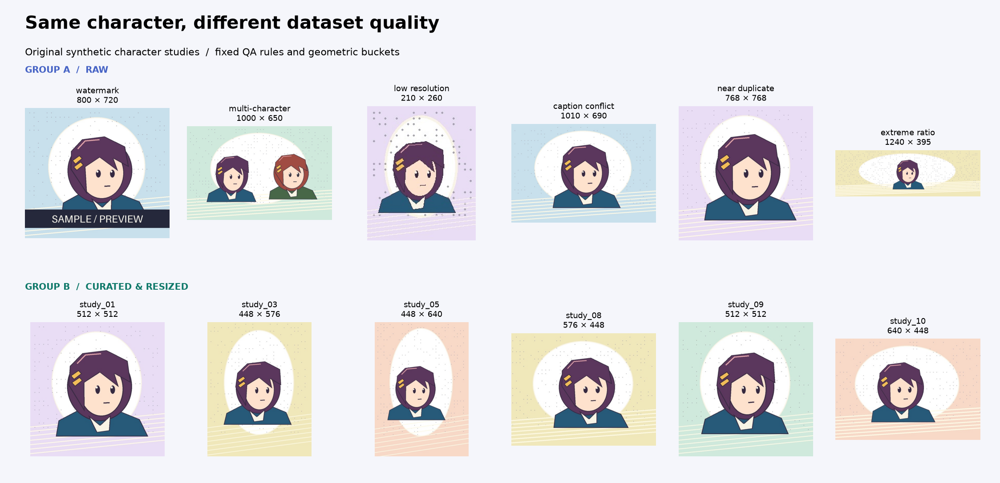
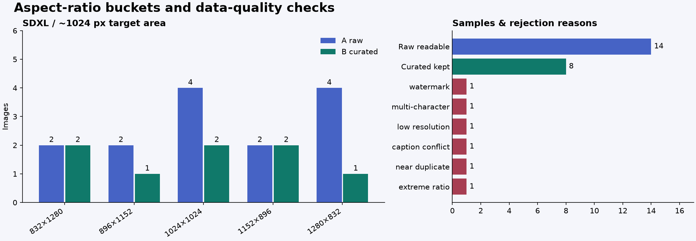
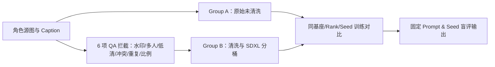

# LoRA 训练数据质检与 A/B 评测管线（lora-data-curation-exp）






## 项目亮点

在角色 LoRA 微调中，“炼丹崩坏”往往不是训练参数的问题，而是训练集混入了水印、多人同框、相互打架的 Tag 或极端长宽比图像。本项目把数据工程中的 QA 思路直接用到 LoRA 备料环节：

1. **6 类脏数据自动化拦截**：从 14 张原始样本中精准追踪并过滤 **6 类典型问题图**（水印图、多人同框、低分辨率、Caption 冲突、pHash 近重复、极端宽高比），保留 **8 张高纯度样本**作为清洗组（Group B），每条剔除记录均可在 `work/curation_audit.json` 溯源。
2. **SDXL 长宽比分桶（Aspect Ratio Bucketing）与去噪**：按照 64px 步长将图像对齐到近似 1024px 目标面积的标准桶中并裁剪，同时清理冗余重复的 Caption Tag，避免训练时画面被强行拉伸。
3. **可复现的 A/B 盲评管线**：两组采用完全一致的模型基座、LoRA Rank、学习率与 Seed（Diffusers + PEFT），生成固定 Prompt × Seed 的配对评测图与盲评打分表（先对“角色特征保留 / 画风污染 / 画面瑕疵”打分，再按 `key.json` 揭晓分组）。

## 实测验证与复现说明

- **本地闭环验证（RTX 4070 Ti）**：已使用 Hugging Face 的 `tiny-stable-diffusion-xl-pipe` 完成 Group A 与 Group B 各 2 步端到端训练、LoRA 权重保存与重新加载，并生成 **3 Prompt × 2 Seed × 2 组 = 12 张** 配对盲评图与打分表，确认数据流、分桶逻辑与评测脚本全链路可跑通。
- **全尺寸 SDXL 复现入口**：仓库内已封装好面向全尺寸 SDXL 1.0 的双组配置文件（`configs/train_a.toml` / `configs/train_b.toml`）及 [Colab 一键运行笔记本](https://colab.research.google.com/github/lubin010319/lora-data-curation-exp/blob/main/train_and_eval_colab.ipynb)，在 Colab GPU 或 AutoDL 上替换权重即可直接拉起完整 120 步对比实验。
- **工程思考**：pHash 去重不能“一刀切”——不同姿势的角色剪影可能出现相近的感知哈希值，因此管线保留了缩略图复查审计；同时在严谨的因果对照实验中，可以通过等量采样进一步隔离“数据总量”与“数据洁净度”各自的贡献。

## 快速运行

需要 Python 3.11+。数据质检、分桶统计与对比图生成在 CPU 上即可完成：

```bash
python -m pip install -r requirements.txt
python curate_lora_dataset.py
```

支持接入自有数据集（每行包含 `id`、`file`、`caption` 及可选质检字段）：

```bash
python curate_lora_dataset.py --manifest path/to/manifest.jsonl
```

在 CUDA 环境下运行本地训练与盲评闭环验证（全尺寸 SDXL 训练将 `smoke_*.toml` 替换为 `train_*.toml`）：

```bash
python -m pip install -r requirements-train.txt
python train_lora.py configs/smoke_a.toml configs/smoke_b.toml
python train_lora.py configs/smoke_a.toml configs/smoke_b.toml --evaluate
```

---

代码采用 MIT 协议；原创角色测试集与质检可视化图按 [CC0 1.0](https://creativecommons.org/publicdomain/zero/1.0/) 开源。参考：[Diffusers SDXL LoRA](https://github.com/huggingface/diffusers/tree/main/examples/text_to_image) · [SDXL Base 1.0](https://huggingface.co/stabilityai/stable-diffusion-xl-base-1.0)
